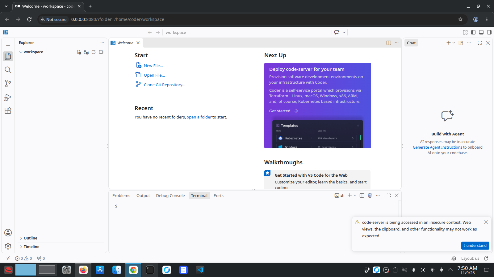

# CodeSite

CodeSite is VS Code running in your browser on localhost, built on a Debian Docker image. You get an editor and a terminal (non-root, `sudo` disabled) with Python, Node.js, Git and build tools preinstalled.



## Run it locally

You need [Docker](https://docs.docker.com/engine/install/) (or Podman) installed.

1. Clone the repository:
   ```bash
   git clone https://github.com/zllai26/codesite.git
   cd codesite
   ```

2. Build the image:
   ```bash
   docker build -t codesite .
   ```

3. Run it:
   ```bash
   docker run --name codesite -p 127.0.0.1:8080:8080 \
     --memory=1g --cpus=1 --pids-limit=256 \
     --cap-drop=ALL --security-opt no-new-privileges \
     codesite
   ```

4. Open http://localhost:8080 in your browser.

Podman users can replace `docker` with `podman`.

### Keep your files

Files inside the container are deleted with it. To keep them, add a volume (on SELinux systems like CentOS/Fedora, add `:Z`):
```bash
-v $(pwd)/workspace:/home/coder/workspace:Z
```

### Stop and remove

```bash
docker stop codesite
docker rm codesite
```

## Security warning

Authentication is **disabled** (`--auth none`). Only bind it to localhost as shown above. Do not expose port 8080 to the internet or a shared network without adding authentication.

## Contribution

Fork the repo and open a PR, email me, or open an issue.

## License

Released under GPL v2.
